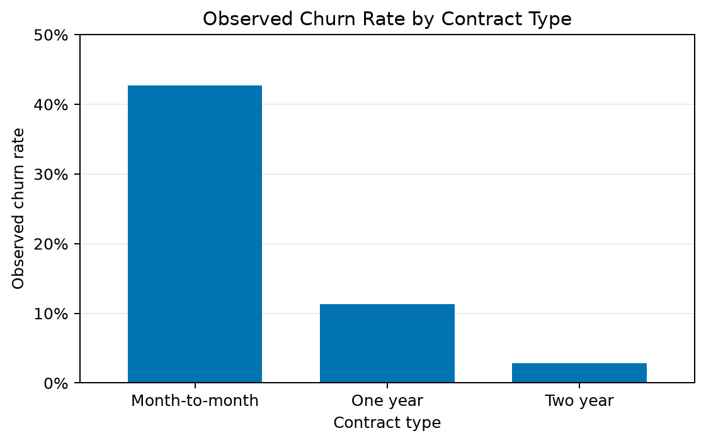
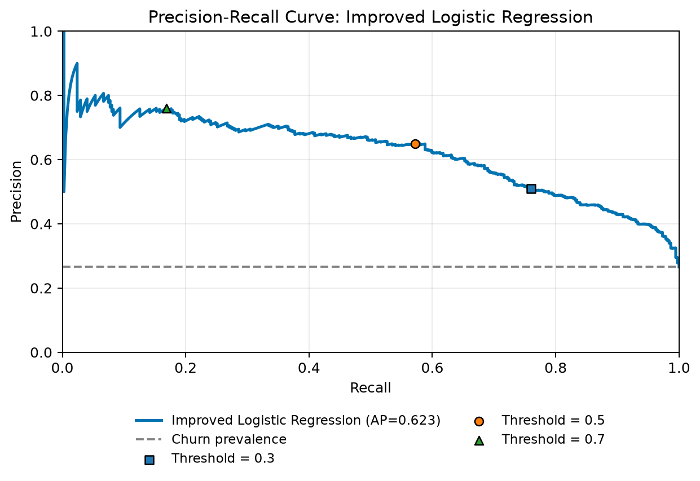

# Telco Customer Churn Analysis

## Business question

Which customer characteristics are associated with churn, and how well can a
simple classifier identify customers with an observed churn outcome?

This project uses the public Telco Customer Churn dataset to explore customer
segments and compare a few interpretable classification baselines. It does not
estimate the causal effect of retention actions.

## Dataset and scope

- **Source:** [Kaggle — Telco Customer Churn](https://www.kaggle.com/datasets/blastchar/telco-customer-churn)
- **Raw file:** 7,043 rows and 21 columns.
- **Preparation:** 11 blank `TotalCharges` values are treated as missing and
  removed, leaving 7,032 records. The tracked CSV is not modified.
- **Target:** `Churn` (`Yes` / `No`), mapped to 1 / 0 for modeling.

The dataset is a customer snapshot. The prediction horizon and operational
availability of every feature are not defined; in particular, cumulative
`TotalCharges` may not be suitable for every prediction time.

## Reproduce the analysis

Requirements: Python 3.14 or newer and [`uv`](https://docs.astral.sh/uv/).

From the repository root:

```bash
uv sync --locked
uv run python -m unittest discover -s tests -v
cd notebooks
uv run --project .. jupyter lab
```

Open `churn_analysis.ipynb` and run all cells from top to bottom. Start
JupyterLab from `notebooks/`: the notebook's data path and import setup assume
that working directory.

## Method

1. Validate the expected columns and `Churn` labels; convert numeric
   `TotalCharges`, remove only rows where it is blank, and reject unexpected
   missing values. The cleaner is in `churn_analysis.py`.
2. Compare customer segment churn rates and monthly-charge averages. These are
   descriptive associations.
3. Use a stratified 80/20 train/test split with `random_state=42`.
4. Fit scaling and one-hot encoding inside each model pipeline. `customerID` is
   excluded from features.
5. Compare a most-frequent `DummyClassifier`, Logistic Regression with and
   without the derived `tenure_group`, and Random Forest on the same split.
6. Report confusion-matrix metrics at an explicit probability threshold of
   `>= 0.5`, plus ROC-AUC and Average Precision from the probability scores.
   The notebook also plots a precision-recall curve and illustrates alternative
   thresholds; it does not select an operational threshold without intervention
   capacity and error-cost assumptions.

## Verified findings

On the cleaned dataset:

- Month-to-month customers have a 42.7% observed churn rate; one-year customers
  11.3%, and two-year customers 2.8%.
- Customers with 1–12 months of tenure have a 47.7% churn rate, compared with
  9.5% for 49–72 months.
- Electronic-check customers have a 45.3% churn rate, compared with 16.7% for
  automatic bank transfer and 15.3% for automatic credit card.
- Average monthly charges are 74.44 for customers who churned and 61.31 for
  customers who stayed.
- Customers without technical support have a 41.6% churn rate, compared with
  15.2% among customers with support.

These are associations in this dataset, not evidence that contract changes,
payment-method changes, or support adoption cause churn to fall.

## Visual highlights

The figures below are exported by running the notebook and are committed under
`reports/figures/` so they render directly in this README.



*Observed churn rate within each contract group; descriptive association, not a
causal estimate.*



*Threshold markers show the precision/recall trade-off; the 0.5 threshold is
used for the model comparison, not asserted to be operationally optimal.*

## Holdout model results

The following results were reproduced by executing the notebook from a fresh
kernel. Threshold-based metrics use `probability >= 0.5`; ROC-AUC and Average
Precision use predicted probabilities.

| Model | Accuracy | Precision | Recall | F1 | ROC-AUC | Average Precision |
|---|---:|---:|---:|---:|---:|---:|
| Dummy (most frequent) | 73.42% | 0.00% | 0.00% | 0.00% | 50.00% | 26.58% |
| Logistic Regression (with `tenure_group`) | 79.39% | 63.55% | 52.67% | 57.60% | 83.49% | 62.71% |
| Logistic Regression (without `tenure_group`) | **80.38%** | **64.85%** | **57.22%** | **60.80%** | **83.59%** | 62.28% |
| Random Forest | 78.46% | 61.87% | 49.47% | 54.98% | 81.37% | 59.42% |

At this threshold, the refined Logistic Regression has the strongest accuracy,
precision, recall, F1, and ROC-AUC among the evaluated models. The Logistic
Regression with `tenure_group` has slightly higher Average Precision. The
refined model's small differences are measured on one holdout split; they do
not establish that it will generalize better to future customers.

Lowering the threshold can find more churn cases while flagging more customers
and potentially lowering precision. Choosing a threshold requires explicit
trade-offs around contact capacity and the relative costs of false positives
and missed churners. Those business inputs are not available here.

On the refined Logistic Regression holdout predictions, the illustrative
thresholds produce:

| Threshold | Precision | Recall | Holdout customers flagged |
|---:|---:|---:|---:|
| 0.3 | 51.08% | 75.94% | 39.52% |
| 0.5 | 64.85% | 57.22% | 23.45% |
| 0.7 | 75.90% | 16.84% | 5.90% |

These are alternative operating points, not a threshold recommendation.

## Limitations and next steps

- Only one random stratified holdout split is used; there is no cross-validation
  or later-period test set.
- The prediction horizon and feature availability at that decision time are not
  defined.
- No intervention costs, contact capacity, or controlled retention experiments
  are available. Recommendations are hypotheses to test, not proven ways to
  reduce churn.
- Average Precision is slightly lower for the refined Logistic Regression than
  for the version with `tenure_group`, so the feature refinement does not
  improve every ranking metric.

Next, validate on multiple folds or a later time period and select a threshold
using agreed business costs and intervention capacity.

## Project structure

```text
Customer-Churn-Analysis/
├── data/
│   └── raw/
│       └── Telco-Customer-Churn.csv
├── notebooks/
│   └── churn_analysis.ipynb
├── reports/
│   └── figures/
│       ├── churn_rate_by_contract.png
│       └── precision_recall_thresholds.png
├── tests/
│   └── test_churn_analysis.py
├── churn_analysis.py
├── pyproject.toml
├── uv.lock
├── README.md
├── LICENSE
└── .gitignore
```
